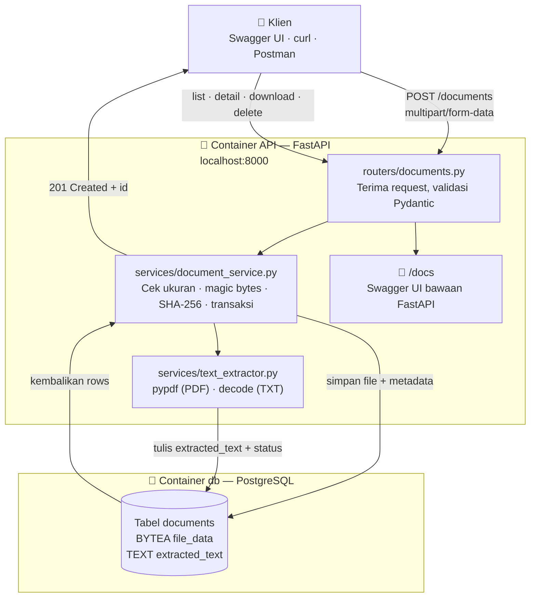
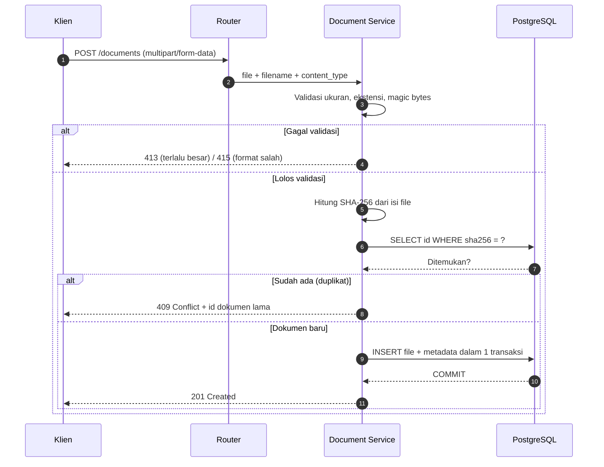

# 📄 Document API — Backend Ingesti Dokumen untuk RAG

> [!abstract] Ringkasan Proyek
> REST API untuk **mengunggah, memvalidasi, menyimpan, dan mengekstrak teks dari dokumen**. FastAPI menangani request dan validasi, PostgreSQL menyimpan file (sebagai `BYTEA`) beserta metadata dan teks hasil ekstraksi. Seluruh stack dijalankan dengan **Docker Compose**. Proyek ini adalah **fondasi (Fase 1)** dari Document RAG Assistant — setelah alur ini stabil, teks yang sudah bersih siap masuk ke tahap chunking → embedding → RAG.

---

## 📋 Informasi Proyek

| Atribut | Nilai |
| --- | --- |
| **Kategori** | Backend Engineering + AI Engineering |
| **Target Posisi** | AI Engineer / Backend Engineer |
| **Status** | 🔴 Belum dimulai |
| **Estimasi Durasi** | 1–2 minggu |
| **Positioning** | Fase 1 dari Document RAG Assistant (Minggu 8 roadmap) |
| **Teknologi Kunci** | FastAPI · PostgreSQL · SQLAlchemy · Alembic · Docker Compose |
| **Tags** | `#project` `#backend` `#fastapi` `#docker` `#postgresql` `#rag` |

---

## 🎯 1. Tujuan & Manfaat

### Tujuan Teknis
- **Ingesti dokumen** — Satu endpoint menerima file dari berbagai sumber (unggah manual, integrasi n8n, crawler) dan menyimpannya secara terstruktur.
- **Validasi berlapis** — Menolak file berukuran berlebihan, format salah, atau ekstensi yang tidak cocok dengan isi file.
- **Deteksi duplikat** — Hash SHA-256 mencegah dokumen sama tersimpan berkali-kali.
- **Ekstraksi teks** — Menyediakan teks bersih dari PDF/TXT sebagai bahan mentah tahap RAG berikutnya.
- **Fondasi yang bisa diuji** — Swagger UI bawaan FastAPI cukup untuk mendemonstrasikan seluruh alur tanpa frontend.

### Nilai Portofolio
> [!success] Mengapa Proyek Ini Menonjol
> Proyek ini menunjukkan kemampuan **desain API yang matang**: kontrak endpoint, status code yang tepat, validasi input berlapis, deduplikasi, migrasi skema, dan orkestrasi multi-service lewat Docker. Semua hal yang justru sering dilewatkan saat membuat portofolio backend.

---

## 📐 2. Batas Lingkup Tahap 1

Batas lingkup yang disengaja, agar proyek selesai cepat dan tetap bisa diuji menyeluruh.

| Aspek | Keputusan | Alasan |
| --- | --- | --- |
| Format didukung | PDF dan TXT saja | Cukup membuktikan dua jalur ekstraksi berbeda |
| Batas ukuran | 10 MB per file | Cukup untuk dokumen portofolio, mudah diuji |
| Penyimpanan file | `BYTEA` di PostgreSQL | Sederhana, tidak perlu object storage |
| Penyimpanan teks | `TEXT` di kolom terpisah | Pemisahan data biner vs teks |
| Antarmuka | Swagger UI `/docs` | Tidak perlu frontend di tahap ini |
| Autentikasi | Belum ada | Fokus pada inti functionality |
| Object storage | Belum ada | Pivot bila koleksi membesar |

> [!important] Keputusan Arsitektur — `BYTEA` vs Object Storage
> Untuk proyek latihan, isi file disimpan sebagai **`BYTEA`** di PostgreSQL, sedangkan teks hasil ekstraksi disimpan sebagai **`TEXT`**. Ini membuat alur mudah dipelajari karena semua data berada di satu tempat.
>
> **Kapan harus pindah:** bila koleksi file membesar, pindahkan penyimpanan file ke object storage (S3 / MinIO), sementara PostgreSQL tetap menyimpan metadata dan lokasi file. Kolom `file_data` tinggal ditukar menjadi `storage_key` — karena itu, pisahkan concerns ini sejak awal di layer `service`.

---

## 🏗️ 3. Arsitektur Sistem

### 3.1 Diagram Komponen



> [!tip] Demo Tanpa Frontend
> Gunakan halaman **`/docs`** bawaan FastAPI untuk mencoba upload. Dengan begitu seluruh endpoint bisa didemokan tanpa membangun frontend sama sekali.

### 3.2 Alur Upload (`POST /documents`)



### 3.3 Prinsip Layer

| Layer | Tanggung Jawab |
| --- | --- |
| **Router** | Menerima request dan mengembalikan respons |
| **Schema** | Mengatur bentuk data API (Pydantic) |
| **Model** | Mendefinisikan tabel database (SQLAlchemy ORM) |
| **Service** | Validasi, hash, penyimpanan, ekstraksi |
| **Migration** | Mencatat perubahan struktur database (Alembic) |

---

## 🗄️ 4. Skema Database

Mulai dengan **satu tabel `documents`** agar tidak over-engineering di tahap awal.

### 4.1 Definisi Tabel

| Kolom | Tipe | Fungsi |
| --- | --- | --- |
| `id` | `UUID`, primary key | Identitas dokumen |
| `filename` | `TEXT` | Nama file asli |
| `content_type` | `TEXT` | Jenis file |
| `size_bytes` | `BIGINT` | Ukuran file |
| `sha256` | `CHAR(64)`, unique | Mendeteksi file identik |
| `file_data` | `BYTEA` | Isi file asli |
| `extracted_text` | `TEXT`, nullable | Teks hasil ekstraksi |
| `status` | `TEXT` | `uploaded` · `processing` · `ready` · `failed` |
| `source_url` | `TEXT`, nullable | Sumber dokumen jika berasal dari internet |
| `error_message` | `TEXT`, nullable | Penyebab ekstraksi gagal |
| `created_at` | `TIMESTAMPTZ` | Waktu upload |

> [!warning] Pisahkan Dua Keberhasilan
> **File berhasil disimpan** ≠ **teks berhasil diekstrak**. PDF hasil scan, misalnya, bisa berhasil disimpan tetapi membutuhkan OCR agar teksnya terbaca. Karena itu `status` dan `error_message` harus terpisah dari keberadaan baris dokumen — jangan pernah menghapus dokumen hanya karena ekstraksi gagal.

### 4.2 Makna Nilai `status`

| Nilai | Arti | Kapan Dipakai |
| --- | --- | --- |
| `uploaded` | File tersimpan, teks belum diambil | Default setelah `POST /documents` |
| `processing` | Ekstraksi sedang berjalan | Saat `POST /documents/{id}/extract` |
| `ready` | Teks berhasil diekstrak | `extracted_text` terisi |
| `failed` | Ekstraksi gagal | `error_message` terisi, file tetap aman |

---

## 🔌 5. Desain Endpoint

### 5.1 Daftar Endpoint

| Method | Endpoint | Fungsi |
| --- | --- | --- |
| `POST` | `/documents` | Upload dan menyimpan dokumen |
| `GET` | `/documents` | Daftar metadata dengan pagination |
| `GET` | `/documents/{id}` | Metadata satu dokumen |
| `GET` | `/documents/{id}/download` | Unduh file asli |
| `POST` | `/documents/{id}/extract` | Ekstrak teks dari file tersimpan |
| `GET` | `/documents/{id}/text` | Ambil hasil ekstraksi |
| `DELETE` | `/documents/{id}` | Hapus dokumen |
| `GET` | `/health` | Cek aplikasi dan koneksi database |

> [!note] Desain Respons
> Endpoint daftar dokumen **hanya mengembalikan metadata** supaya responsnya ringan. Jangan pernah menyertakan `file_data` atau `extracted_text` di respons list — untuk 50 dokumen dengan teks masing-masing 50 KB, itu 2,5 MB per request.

**Contoh respons upload (`201 Created`):**

```json
{
  "id": "b62c0a50-2c06-4fd5-8a42-38aaef55cf36",
  "filename": "sop-cuti.pdf",
  "size_bytes": 125430,
  "status": "uploaded"
}
```

### 5.2 Kode Error

| Situasi | HTTP Status | Alasan |
| --- | --- | --- |
| File duplikat (SHA-256 sama) | `409 Conflict` | Resource sudah ada |
| File melebihi 10 MB | `413 Content Too Large` | Melewati batas ukuran |
| Format di luar PDF/TXT | `415 Unsupported Media Type` | Format tidak didukung |
| Ekstensi tidak cocok dengan isi file | `415 Unsupported Media Type` | Validasi magic bytes |
| Dokumen tidak ditemukan | `404 Not Found` | UUID tidak terdaftar |
| Ekstraksi gagal (mis. PDF scan) | `200 OK` dengan `status: failed` | File tetap tersimpan, `error_message` menjelaskan |

---

## 📂 6. Struktur Proyek

```text
document-api/
├── app/
│   ├── main.py                 # Inisialisasi FastAPI & registrasi router
│   ├── config.py               # Settings via environment variables
│   ├── database.py             # Engine & session SQLAlchemy
│   ├── models/
│   │   └── document.py         # Definisi tabel documents
│   ├── schemas/
│   │   └── document.py         # Pydantic schema request/response
│   ├── routers/
│   │   └── documents.py        # Endpoint HTTP
│   └── services/
│       ├── document_service.py # Validasi, hash, penyimpanan
│       └── text_extractor.py   # Ekstraksi teks PDF/TXT
├── migrations/                 # Versi skema via Alembic
├── sample_documents/           # Dokumen uji + file edge case
├── Dockerfile
├── compose.yaml
├── requirements.txt
├── .env.example
├── .gitignore
└── README.md
```

### 6.1 Tech Stack

| Kategori | Library | Fungsi |
| --- | --- | --- |
| Web framework | `fastapi` + `uvicorn` | REST API + dokumentasi otomatis |
| Upload | `python-multipart` | Parsing `multipart/form-data` |
| ORM | `SQLAlchemy` | Abstraksi query & model |
| Driver | `psycopg` | Koneksi PostgreSQL |
| Migrasi | `alembic` | Versioning skema tabel |
| Ekstraksi | `pypdf` | Ambil teks dari file PDF |

> [!warning] Dependency yang Sering Terlupa
> Tanpa **`python-multipart`**, FastAPI akan menolak endpoint upload dengan error `422` yang membingungkan. Package ini wajib ada di `requirements.txt` begitu ada endpoint yang menerima file.

---

## 🐳 7. Desain Docker

Docker Compose menjalankan **dua service** dengan satu perintah.

### 7.1 Komponen Docker

| Service | Fungsi | Koneksi |
| --- | --- | --- |
| `api` | Menjalankan FastAPI | Diakses host lewat `localhost:8000` |
| `db` | Menjalankan PostgreSQL | Diakses API lewat `db:5432` |
| Volume `postgres_data` | Menyimpan data PostgreSQL | Tetap tersedia saat container dibuat ulang |

> [!important] Memahami Hostname di Dalam Docker
> Dari dalam container FastAPI, alamat database adalah **`db`** — itulah nama service PostgreSQL di Compose. `localhost` di dalam container API merujuk ke container API itu sendiri, bukan ke PostgreSQL. Kesalahan ini penyebab nomor satu "`connection refused`" pada proyek Docker Compose pemula.

### 7.2 Urutan Startup

1. Compose menyalakan PostgreSQL.
2. **Health check** menunggu database siap menerima koneksi.
3. Menjalankan **migration** (Alembic).
4. Menjalankan **FastAPI**.
5. Buka `http://localhost:8000/docs`.

> [!tip] Manajemen Kredensial
> Simpan kredensial lewat **environment variables**, dan sediakan file **`.env.example`** berisi nilai contoh agar orang lain tahu variabel apa yang perlu diisi. File `.env` lokal **tidak** dimasukkan ke Git — pastikan sudah masuk `.gitignore`.

---

## 📄 8. Sumber Dokumen Sample

### 8.1 Dokumen Fiktif Sendiri (Rekomendasi Utama)

Untuk tahap awal, **buat dokumen perusahaan fiktif sendiri**. Keuntungannya: kamu mengatur isi dokumen, mengetahui jawaban yang benar, dan bisa membagikannya sebagai bagian portofolio.

Gunakan satu perusahaan contoh, misalnya **PT Contoh Digital**, lalu buat:

| Dokumen | Contoh Isi | Pertanyaan Uji untuk Tahap RAG |
| --- | --- | --- |
| Kebijakan cuti | Hak cuti, prosedur pengajuan, persetujuan | "Bagaimana cara mengajukan cuti?" |
| SOP reimbursement | Bukti transaksi, batas nominal, tenggat | "Apa syarat reimbursement?" |
| Panduan onboarding | Akun kerja, orientasi, checklist | "Apa yang dilakukan karyawan baru?" |
| SOP bantuan IT | Tiket gangguan, prioritas, eskalasi | "Bagaimana melaporkan laptop rusak?" |
| FAQ produk | Fitur, paket, batas layanan | "Apa perbedaan paket Basic dan Pro?" |

> [!tip] Label Konteks
> Beri label **"Dokumen simulasi untuk portofolio"** di README dan di dalam dokumen, agar pembaca tidak salah mengira ini dokumen perusahaan sungguhan.

### 8.2 Dokumen Nyata (Alternatif)

Kalau ingin memakai dokumen nyata, cari panduan atau FAQ yang diterbitkan secara publik oleh organisasi. Contoh pola pencarian:

```text
filetype:pdf panduan layanan site:ac.id
filetype:pdf standar operasional prosedur site:go.id
filetype:pdf panduan penggunaan nama-produk
```

> [!warning] Perhatikan Lisensi
> Pilih **satu tema** agar koleksinya konsisten, dan **catat URL sumber, tanggal pengambilan, serta izin penggunaan**. Dokumen yang bisa diakses publik belum tentu boleh dibagikan ulang — periksa status hak cipta sebelum memamerkannya di portofolio publik.

### 8.3 Fixture Pengujian

Untuk tahap pertama, siapkan **5–10 dokumen pendek dengan teks yang bisa diseleksi**, lalu tambahkan file uji sengaja bermasalah:

- [ ] **1 file duplikat** — untuk menguji deteksi SHA-256 dan respons `409`
- [ ] **1 PDF hasil scan** — untuk menguji kondisi `status: failed` (butuh OCR)
- [ ] **1 file tidak valid** — untuk menguji penolakan magic bytes
- [ ] **1 file melebihi 10 MB** — untuk menguji batas ukuran dan respons `413`

---

## 🗺️ 9. Roadmap Pengerjaan

### Fase 1 — Docker & Koneksi ⏱️ ~2 hari
- [ ] Susun `compose.yaml` dengan service `api` + `db` dan volume `postgres_data`
- [ ] Tulis `Dockerfile` + `requirements.txt` (jangan lupa `python-multipart`)
- [ ] Hubungkan FastAPI ke PostgreSQL lewat `db:5432` dan uji `/health`
- [ ] Siapkan `.env.example` dan masukkan `.env` ke `.gitignore`

### Fase 2 — Upload & Download ⏱️ ~3 hari
- [ ] Buat model SQLAlchemy + migrasi Alembic pertama untuk tabel `documents`
- [ ] Implementasikan `POST /documents`: validasi ukuran, ekstensi, magic bytes
- [ ] Hitung SHA-256 dan tangani duplikat dengan `409`
- [ ] Implementasikan `GET /documents/{id}/download` dan verifikasi isinya identik

### Fase 3 — List & Delete ⏱️ ~1 hari
- [ ] `GET /documents` dengan pagination, metadata saja (tanpa `BYTEA`)
- [ ] `GET /documents/{id}` dan `GET /health`
- [ ] `DELETE /documents/{id}`

### Fase 4 — Ekstraksi Teks ⏱️ ~3 hari
- [ ] `services/text_extractor.py`: parser `pypdf` untuk PDF, decode untuk TXT
- [ ] `POST /documents/{id}/extract` dengan transisi status `uploaded → processing → ready`
- [ ] Tangani PDF scan: `status: failed` + `error_message`, file tetap tersimpan
- [ ] `GET /documents/{id}/text`

### Fase 5 — Hardening & Portofolio ⏱️ ~2 hari
- [ ] Uji seluruh fixture edge case (§8.3) dan pastikan status code benar
- [ ] Verifikasi data tetap ada setelah `docker compose down` lalu `up` lagi
- [ ] Tulis `README.md` berisi arsitektur, cara jalankan, dan contoh curl
- [ ] Rekam video demo singkat untuk LinkedIn

### Fase 6 — Evaluasi & Lanjut ke RAG ⏱️ ~1 hari
- [ ] Ukur cakupan ekstraksi: berapa persen teks PDF yang berhasil diambil
- [ ] Dokumentasikan temuan (mis. PDF dengan layout kolom membutuhkan parser lain)
- [ ] Lanjut ke chunking → embedding → vector store untuk tahap RAG

---

## ✅ 10. Kriteria Selesai (Definition of Done)

**Fungsionalitas:**
- [ ] `docker compose up` menyalakan API + PostgreSQL dalam satu perintah
- [ ] File yang diunggah bisa diunduh kembali dengan **isi identik**
- [ ] Data **tetap tersedia setelah container di-restart** (terbukti oleh volume)
- [ ] Ekstraksi teks berhasil untuk PDF dan TXT; PDF scan ditangani tanpa crash

**Keamanan & Validasi:**
- [ ] Duplikat terdeteksi via SHA-256 dengan respons `409`
- [ ] File > 10 MB ditolak `413`, format salah ditolak `415`
- [ ] Ekstensi file tidak cukup dipercaya — magic bytes diverifikasi

**Dokumentasi & Demo:**
- [ ] Semua endpoint terdokumentasi di `/docs` dan teruji manual
- [ ] README profesional + video demo singkat untuk portofolio

---

## ⚠️ 11. Trade-off yang Disadari

| Keputusan | Keuntungan | Konsekuensi & Mitigasi |
| --- | --- | --- |
| File di `BYTEA` | Sederhana, satu sumber kebenaran | Boros row size PostgreSQL. Mitigasi: pindah ke object storage saat koleksi membesar |
| Validasi berbasis ekstensi | Cepat & mudah | Mudah ditipu. Mitigasi: tambahkan pemeriksaan magic bytes |
| Tanpa autentikasi | Fokus ke inti fitur | Tidak aman untuk produksi. Mitigasi: tambahkan auth sebelum expose publik |
| Ekstraksi sinkron di request | Sederhana untuk tahap 1 | PDF besar bisa timeout. Mitigasi: naikkan ke background job saat RAG mulai jalan |
| Tanpa OCR | Tidak perlu dependency berat | PDF scan tidak terbaca. Mitigasi: deteksi via `status: failed`, rencanakan Tesseract |

---

## 🔗 12. Tautan Internal (Knowledge Graph)

### Proyek & Roadmap
- [[03 - Document RAG Assistant/Index|Document RAG Assistant]] — proyek induk; dokumen ini adalah Fase 1-nya
- [[05 - Portfolio Projects/Index|Portfolio Projects]] — daftar seluruh proyek portofolio
- [[AI Engineer Dashboard]] — dashboard dan roadmap 12 minggu

### Materi Pembelajaran yang Relevan
- [[04 - REST API/01 - FastAPI untuk AI Applications]] — pola endpoint, dependency injection, pengujian API
- [[06 - Docker/01 - Docker untuk AI Applications]] — containerisasi aplikasi AI
- [[03 - SQL dan Database/Index]] — desain skema dan migrasi
- [[05 - Testing/01 - Testing untuk Aplikasi AI dengan pytest]] — pengujian endpoint upload
- [[03 - Generative AI/06 - RAG|RAG]] — tujuan akhir dari teks yang diekstrak di dokumen ini

### Proyek Serupa di Vault
- [[End-to-End Stock & Sentiment Pipeline]] — pola orkestrasi Docker Compose + FastAPI + PostgreSQL yang sudah dikuasai

---

## 🎓 13. Catatan untuk Mentor (Codex)

> [!quote] Panduan Pengerjaan Proyek
> Proyek ini sengaja dibuat **kecil tapi benar-benar jalan**. Banyak portofolio berhenti di "saya bisa upload file" — nilai sebenarnya ada pada detail yang jarang dikerjakan: status code yang tepat, validasi berlapis, deduplikasi, pemisahan status ekstraksi dari status penyimpanan, dan data yang selamat dari container restart. Enam hal itu yang akan membuat reviewer kagum.

**Prinsip belajar saat mengerjakan:**
1. Setiap endpoint baru → tentukan dulu status code untuk kasus sukses/gagal sebelum menulis kode.
2. Setiap perubahan schema → tanyakan dulu "ini butuh migrasi Alembic?".
3. Setiap debugging → tulis dulu apa yang dicoba, error, dan ekspektasi.
4. Setiap sub-fase selesai → catat 3 baris pelajaran yang didapat.
5. Kode dari AI wajib **diketik ulang manual**, bukan copy-paste.

---

## 📌 Ringkasan Cepat

| Item | Nilai |
| --- | --- |
| **Total fase** | 6 fase |
| **Total estimasi** | ~12 hari kerja efektif (1–2 minggu) |
| **Endpoint** | 8 endpoint |
| **Tabel database** | 1 tabel (`documents`) |
| **Service Docker** | 2 service (`api`, `db`) |
| **Output akhir** | API siap jadi fondasi RAG Assistant + portofolio LinkedIn |

---

*Dokumen ini adalah bagian dari vault belajar AI Engineer. Untuk perubahan signifikan pada arsitektur, perbarui dokumen ini dan catat alasan perubahan di §11 (Trade-off).*
